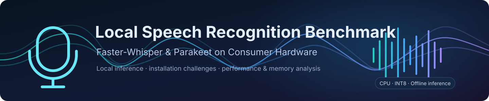
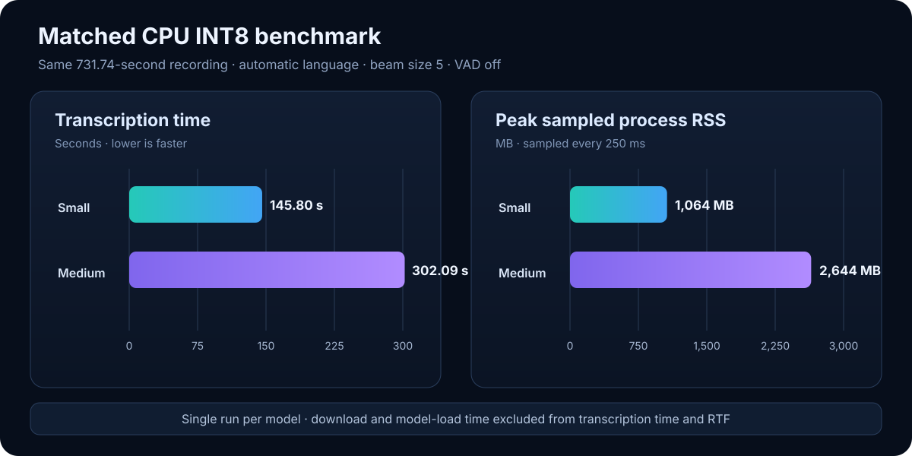
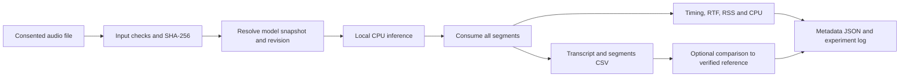
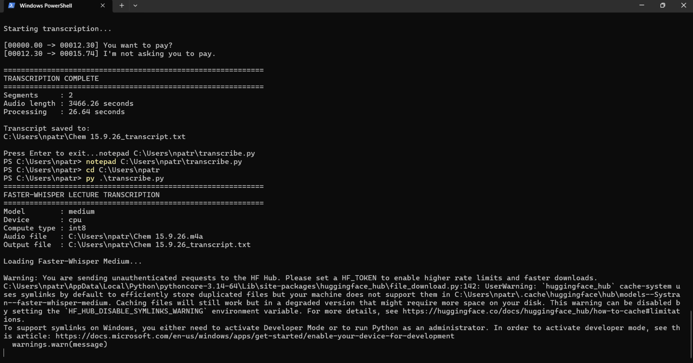
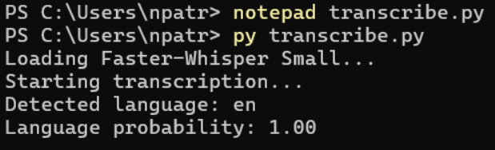
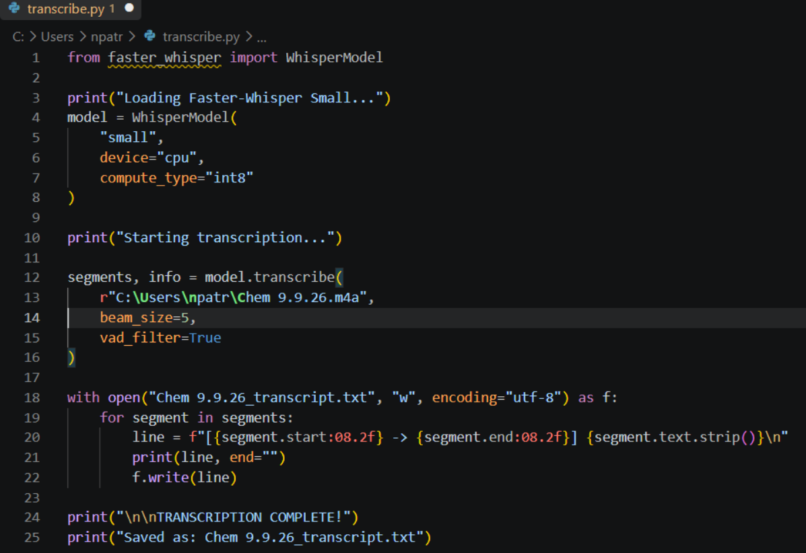
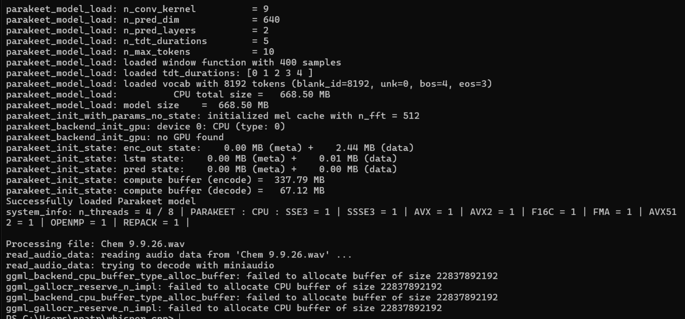
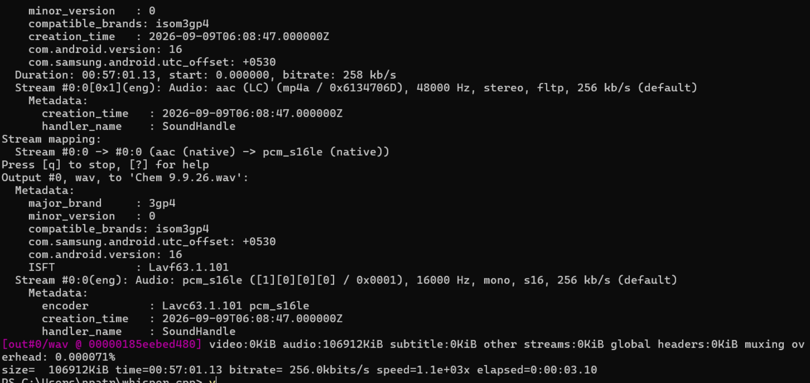
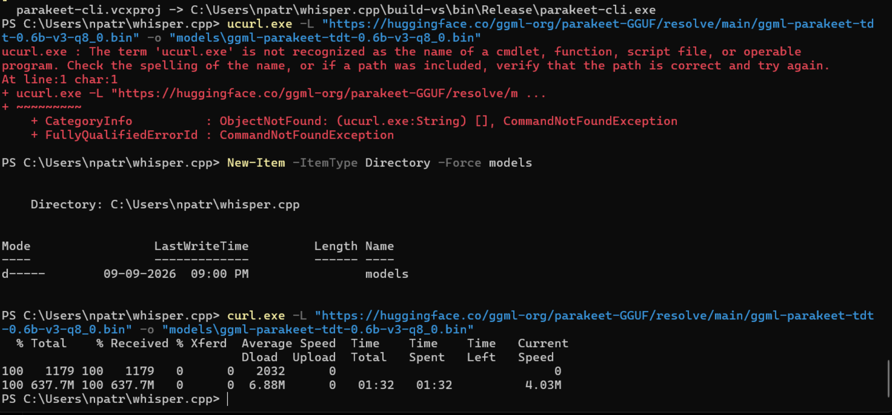

# Local Speech Recognition Benchmark

**Faster-Whisper & Parakeet on consumer hardware**



    

> A hands-on study of local automatic speech recognition (ASR): getting models running, measuring speed and memory, investigating Voice Activity Detection (VAD), and documenting what worked—and what did not—on a Windows consumer system.

## Project at a glance

This project evaluates the practical side of running speech-to-text models locally rather than sending recordings to a hosted transcription API. It combines a reproducible **Faster-Whisper evaluation harness** with a chronological record of earlier Parakeet experiments, installation failures, fixes, and measured results.

- **Implemented:** a CPU-first Faster-Whisper evaluation tool with run metadata, model revision capture, resource sampling, optional reference-based WER/CER, and CSV/text/JSON outputs.
- **Benchmarked:** Faster-Whisper Small and Medium on the same 12-minute recording with matched decoding settings.
- **Investigated:** a Parakeet/GGUF workflow and a memory-allocation failure on the tested system.
- **Documented:** setup problems, dependency recovery, VAD diagnostics, evidence screenshots, and reproducible setup steps.
- **Verified:** 28 automated tests passed in the packaged test suite.

## Headline benchmark: Small vs Medium

Both runs processed the same **731.74-second (12 min 11.74 sec)** recording. The original recording was kept unchanged.



| Metric | Faster-Whisper Small | Faster-Whisper Medium |
|---|---:|---:|
| Transcription time | **145.80 s** | 302.09 s |
| Real-time factor (RTF) | **0.19925** | 0.41283 |
| Peak sampled process RSS | **1,064.01 MB** | 2,644.46 MB |
| Average sampled process CPU | 358.43% | 385.76% |
| Segments emitted | 63 | 147 |
| Detected language | English | English |
| Model revision | `536b0662742c02347bc0e980a01041f333bce120` | `08e178d48790749d25932bbc082711ddcfdfbc4f` |

**What the measurements say:** Small was approximately **2.07× faster** and used approximately **2.49× less peak sampled process memory** in these runs. Both completed faster than the recording's playback duration.

### Benchmark conditions

- Windows 11 x64; CPython 3.12.10; approximately 23.96 GiB system RAM reported by the evaluator.
- CPU inference; requested compute type `int8` (runtime reported `int8_float32`). No CUDA/GPU inference was used.
- Automatic language detection, beam size 5, VAD disabled, and the same original 731.74-second M4A input.
- Transcription timing includes consuming Faster-Whisper's lazy segment generator. Model download/cache and load times are reported separately.
- Process RSS and CPU were sampled every 250 ms; short resource peaks may be missed.

**Important accuracy limitation:** There is no human-verified reference transcript for this recording, so WER/CER were not measured. The Small transcript received a positive subjective assessment; Medium contained some recognizable lecture-specific terms but also fragmented text. These observations do not establish an accuracy winner. Each model has one measured run, not a repeated-run median.

## What was investigated

### 1. Local inference and resource use

The evaluator records model repository and resolved commit, download/cache time, load time, transcription time, real-time factor, segment count, detected language, sampled process RSS/CPU, input hashes, environment versions, and optional WER/CER when a verified reference is supplied.

### 2. Installation and troubleshooting

| Challenge | What happened | Resolution / outcome |
|---|---|---|
| Python runtime discovery | The initial setup script reported `No suitable Python runtime found`. | Replaced the discovery logic to enumerate installed Python 3.11/3.12 runtimes before selecting one. |
| CTranslate2 wheel download | pip repeatedly disconnected near 19 MB of a 20.4 MB wheel. | Retried with `--resume-retries 15 --timeout 120`; installation completed. |
| Hugging Face Xet support | `hf_xet` was not installed. | Non-fatal: the client fell back to regular HTTP download. |
| Windows symlink support | Hugging Face warned that symlinks were unavailable. | Non-fatal: caching continued with a less space-efficient fallback. |

### 3. Voice Activity Detection

The default whole-file VAD run retained only about **3.84 seconds (0.52%)** of the 731.74-second recording. This was not a valid full-recording transcription benchmark. Separate timestamp diagnostics showed that retained duration varied substantially with processing-window size and threshold. VAD is therefore not recommended for this recording with the current settings; retained audio is not automatically the same as correctly detected speech.

### 4. Parakeet exploration

An earlier Parakeet attempt reached an attempted CPU buffer allocation of approximately **22.8 GB** and failed on the tested system. A separate GGUF-based workflow was documented as successful with chunking constraints, but the exact successful model artifact, revision, conversion and runtime were not preserved sufficiently for reproducibility. Parakeet is therefore documented as an exploratory investigation, not included in the current executable benchmark package.

## Evaluation workflow



## Run it yourself

The repository contains a CPU-first Windows setup script, a Small-model runner, pinned direct dependencies, and automated tests. Model weights are downloaded from Hugging Face on first use; inference itself runs locally.

### 1. Clone and set up

```powershell
git clone https://github.com/nytro-gg/local-speech-model-evaluation.git
cd local-speech-model-evaluation
Set-ExecutionPolicy -Scope Process Bypass
.\scripts\setup.ps1
```

The setup script selects an installed 64-bit Python 3.11 or 3.12, creates a project-local `.venv`, installs pinned dependencies, checks package consistency and native imports, and runs the tests.

### 2. Run the first short test

Place a consented 30–120 second audio clip in `audio/`, then run:

```powershell
.\scripts\run-small.ps1 -Audio .\audio\sample.wav
```

The helper intentionally caps the first run at 120 seconds. For a longer file, use the CLI explicitly and set a duration limit you intend to process:

```powershell
.\.venv\Scripts\python.exe -m src.evaluate --audio .\audio\sample.wav --model medium --device cpu --compute-type int8 --max-audio-seconds 900
```

Use your own permitted test audio. Do not upload private recordings or transcripts to this repository.

### 3. Optional accuracy measurement

Supply a human-checked, verbatim reference transcript with `--reference` (or `-Reference` in the PowerShell helper) to calculate WER/CER. Without a verified reference, the evaluator does not claim formal transcription accuracy.

## Experimental evidence

The screenshots below document selected earlier development and model experiments. They are supporting evidence, not screenshots of the matched November Small/Medium benchmark run.

<p align="center">
  
  
  
</p>
<p align="center">
  
  
  
</p>

## Repository map

| Path | Purpose |
|---|---|
| `src/evaluate.py` | Faster-Whisper evaluation CLI and measurement pipeline |
| `scripts/setup.ps1` | Windows environment setup, dependency and import checks |
| `scripts/run-small.ps1` | Guarded first-run helper (120-second limit) |
| `tests/test_evaluate.py` | Automated test suite |
| `experiments/experiment-log.md` | Chronological lab notebook: commands, failures, fixes and observations |
| `results/results.md` | Detailed measured results |
| `results/model-comparison.md` | Concise model and VAD comparison |
| `docs/benchmark-methodology.md` | Matched benchmark protocol, calculations and limitations |
| `docs/installation-and-troubleshooting.md` | Setup issues and resolutions |
| `report/technical-report.md` | Consolidated technical report |
| `evidence/` | Selected historical screenshots |

## Limitations and next steps

- The Small/Medium comparison is one run per model on one recording; repeated runs and medians are not available.
- No human-verified reference transcript was supplied; formal WER/CER and an accuracy ranking are unavailable.
- The verified package is CPU-only. CUDA/GPU compatibility and GPU resource measurements were not tested.
- The VAD behavior on this recording needs further diagnosis before it can be recommended.
- The exact earlier Parakeet artifact is not sufficiently documented for a reproducible re-run.
- Broader testing needs a consented, human-labelled set spanning speakers, accents, noise conditions, silence and longer recordings.

## Detailed documentation

- [Benchmark methodology and metrics](docs/benchmark-methodology.md)
- [Installation and troubleshooting log](docs/installation-and-troubleshooting.md)
- [Package quickstart](docs/package-quickstart.md)
- [Technical report](report/technical-report.md)
- [Experiment environment](report/experiment-environment.md)
- [Full experimental results](results/results.md)
- [Chronological experiment log](experiments/experiment-log.md)
- [Model notes](MODEL_NOTES.md)
- [Test protocol](TEST_PROTOCOL.md)
- [Verification report](VERIFICATION_REPORT.md)

---

**Project:** [nytro-gg/local-speech-model-evaluation](https://github.com/nytro-gg/local-speech-model-evaluation)  
**Focus:** local ASR · reproducible experiments · Python · Windows · performance measurement
